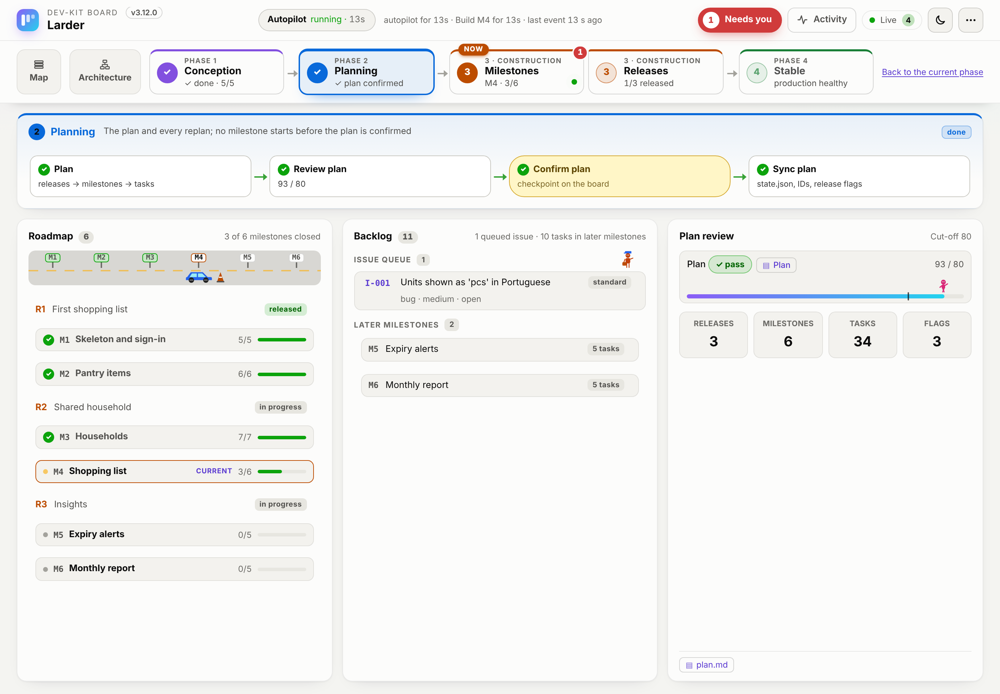
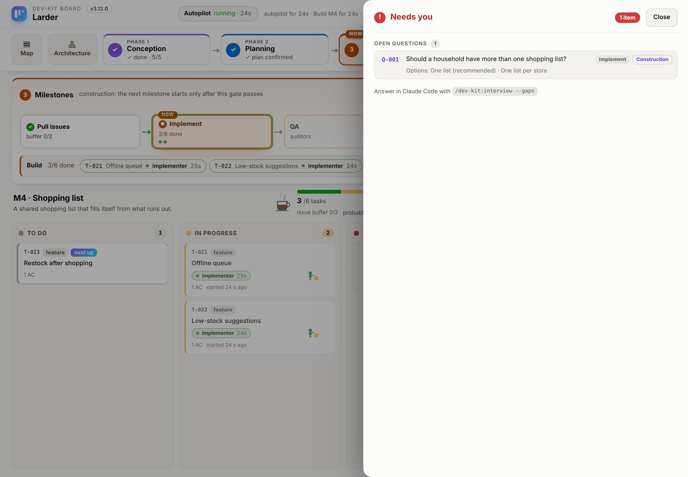
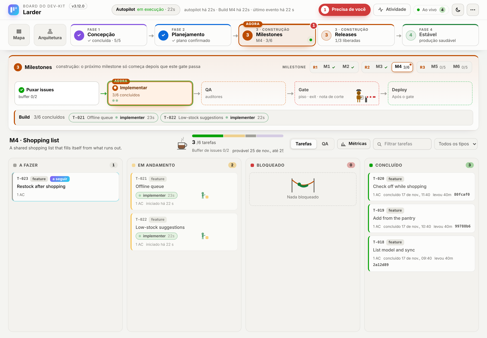
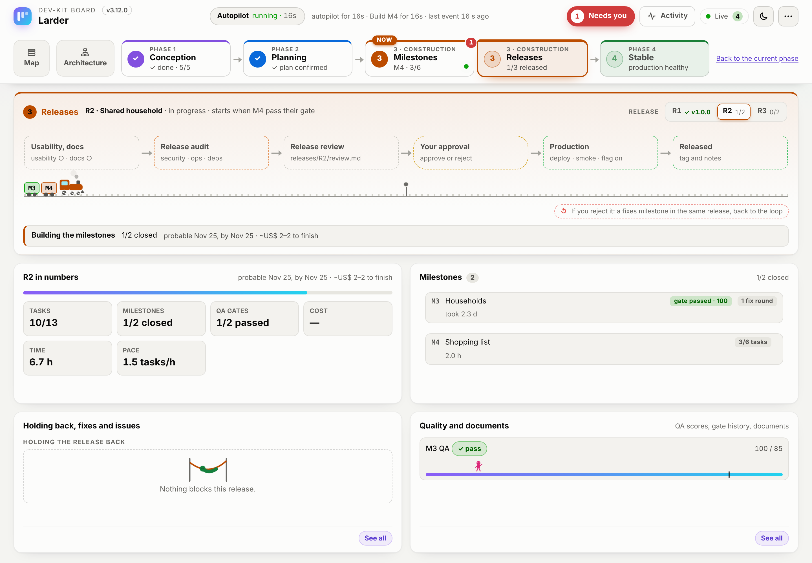
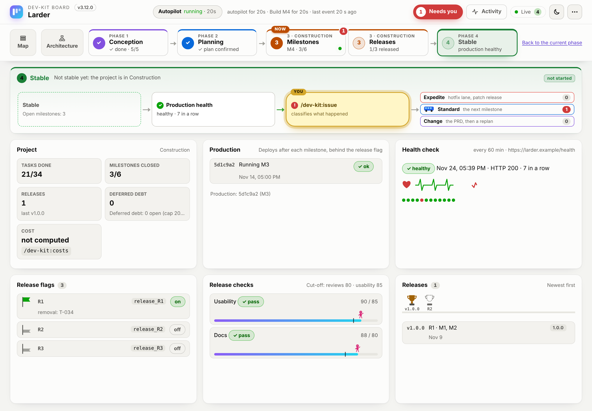

# Getting started

Your first project with the dev-kit, step by step. Inside Claude Code, `/dev-kit:help` answers any "how do I…?" at any time. The whole flow on one page: the [flow diagram](dev-kit-flow.svg).

## 1. Install

```
/plugin marketplace add efranceschi/dev-kit
/plugin install dev-kit@dev-kit
```

To try it without installing: `claude --plugin-dir .claude/plugins/dev-kit`. Open Claude Code in an empty folder (or an existing repository).

## 2. Start and answer the interview

```
/dev-kit:start a personal expense tracker with login and monthly reports
```

`start` runs `git init` if needed and opens the **interview**: about 10 short rounds (product, users, scope, data, stack, integrations, UX/UI, quality, autonomy, delivery). Every question has a recommended option and a "decide for me" choice. It ends with a summary to confirm and writes `.dev/brief.md`.

Answers that matter most later:
- **Quality bar** (`standard`, `premium`, `prototype`): the score each milestone must reach.
- **How much of the run you want to follow** (`supervised` or `unattended`).
- **Issues found during the build:** buffer per milestone and cool-down.
- **Delivery:** local preview per milestone and how production is deployed.

## 3. Review the documents first (recommended)

```
/dev-kit:autopilot --until plan
```

This finishes **conception** (PRD, architecture, UX/UI specs, each reviewed) and **planning** (the plan, reviewed), then stops. Mistakes are cheapest here, so the kit asks you twice: after the PRD review (**Confirm PRD**) and after the plan review (**Confirm plan**). The kit shows a summary of the document (the PRD's personas, stories and acceptance criteria; the plan's releases, milestones with their `exit_check` and task counts) (the board's **Needs you** shows it too, with a link that opens it whole). Confirm, or ask for changes in your own words: the document is revised, reviewed again and comes back to you. Nothing is built before the plan is confirmed.



## 4. Build

```
/dev-kit:autopilot
```

Now the project is in **construction**. It implements each milestone test-first (one commit per task), runs the quality gate (`qa`), fixes what failed and moves to the next milestone. A gate passes only with the hard floor met (build, tests, no secrets), the milestone's `exit_check` passing and every scored dimension at or above the cut-off. Questions that need you are asked in the session with a recommended answer (in an unattended run they are parked for `/dev-kit:interview --gaps`, and the board lists them in Needs you). Building and QA belong to each milestone, so the project phase stays `construction` the whole time; `/dev-kit:status` says which milestone (`construction · M2`). Prefer to drive it yourself? After each document, its review: `/dev-kit:prd` → `/dev-kit:review prd` → `/dev-kit:architecture` → `/dev-kit:ux` → `/dev-kit:ui` → `/dev-kit:review design` → `/dev-kit:plan` → `/dev-kit:review plan`; then `/dev-kit:implement --milestone M1` and `/dev-kit:qa M1`. `release` checks that every review passed.

**Follow it on the board.** `/dev-kit:board` shows the run as it happens: the top bar shows the Autopilot while `/dev-kit:autopilot` runs, and the task board its implementers at work (`--parallel N`, 1 to 6, default 3: how many tasks are built in parallel, each in its own worktree). The board only shows the project; the run is started and stopped in Claude Code. Only one autopilot drives a project at a time.

Needs you, the red button in the top bar, holds everything that waits for you: questions with the recommended answer first, Confirm PRD and Confirm plan and release approvals, each with the command that settles it in Claude Code.



## Already have a project?

Run `/dev-kit:start <the change you want>` in the repository root (commit pending work first). In a codebase that was not built with dev-kit, `start` first runs an **onboarding**: it tags the current commit `dev-kit-baseline`, writes `.dev/discovery.md` (stack, commands, your commit/version/CHANGELOG conventions, existing docs and ADRs), records the current test results in `.dev/qa/baseline.md`, and asks for an entry mode and the number of the first milestone (default `M1`; continue your own numbering if you have one):

| mode | use it when | what happens |
|---|---|---|
| feature | you want a new capability | short interview about the change, then PRD (as-built + new), plan and build |
| maintenance | you only fix bugs and make small improvements | an as-built PRD and an empty maintenance milestone are written for you; report work with `/dev-kit:issue`, and `/dev-kit:qa` gates each batch |
| import | you already have a PRD, specs or ADRs | they become the source; only the gaps are asked |

Nothing in your code, docs or history is changed by the onboarding. From then on QA scores only what changed since the baseline, and problems that were already there become low-priority issues instead of blocking the gate. Commits follow your project's style. If a stage was skipped, `/dev-kit:start` routes to it; a stage that does not apply (e.g. design when there is no new UI) is recorded as `n/a`.

## 5. Follow along

| You want | Run |
|---|---|
| where the project stands (lifecycle phase and step, next release) | `/dev-kit:status` |
| a live board in the browser (or on your phone), with a forecast to finish | `/dev-kit:board` (`--host 0.0.0.0` to share it) |
| change autonomy, cut-offs, flags, the health check | `/dev-kit:settings` |
| what is pending and what to do next | `/dev-kit:backlog` |
| report a bug or an idea | `/dev-kit:issue "what happens"` |
| how much it cost | `/dev-kit:costs` |
| an evaluation of the session | `/dev-kit:feedback` |
| help with anything | `/dev-kit:help <question>` |

The board shows the project's language (English or Portuguese for now, else your browser's); its menu switches it.



## 6. Release, and keep the product evolving

The plan groups milestones into **releases** (R1, R2…). When every milestone of a release has passed its gate, `/dev-kit:release` runs the usability audit (apps with a UI), the docs and their review and the release audit, then writes the **release review** (`.dev/releases/R<n>/review.md`: what is in it, scores, risks, how to roll back) and waits for **your approval** in `/dev-kit:release` (the board shows it waiting). Approve, and it deploys to production when configured, runs the smoke check, tags and records the version. Reject with what must change, and that becomes a fixes milestone in the same release; no milestone of the next release starts before. `autopilot` drives all of this for you up to your approval.



**Production before the release** (optional). With `production.when = per_milestone_flagged` and release flags on (`/dev-kit:settings`), each milestone goes to production as soon as its gate passes, behind its release's flag (`release_R2`), off; the flag is turned on only after you approve the release, and a chore to remove it is planned in the next release. A **production health check** (`production.health`: a command or a URL, with an interval) runs at each milestone of the autopilot and with `/dev-kit:status` when its interval passed, or with `/dev-kit:deploy --health`; a failure opens one urgent (expedite) issue and shows in Needs you. `/dev-kit:deploy --rollback R2` turns the flag off again.



With no milestone open, no issue queued and everything released, the project is **stable**. That is a resting point, not an end:

- a bug or improvement (`/dev-kit:issue`) goes straight to construction, as a task in the current or next milestone;
- a scope change reopens **conception** (the PRD and the specs it affects) and **planning** (replan into future milestones), while the milestone being built keeps going;
- either way the project goes back to construction, and to stable after the next release.

The phase is worked out from `.dev/` (artifacts, reviews, gates, issues, releases), never typed in, so it always matches the work: see [concepts](concepts.md#lifecycle-conception-planning-construction-19).

Next: [stage by stage](stages.md) for what each stage expects from you and how to get unstuck (and how to come from 2.x), [recipes](recipes.md) for common tasks, [concepts](concepts.md) for how it works, [skills](skills.md) for every command.
