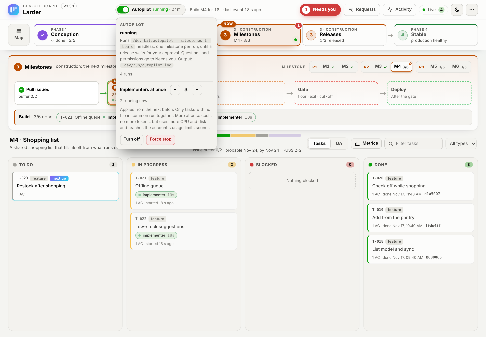
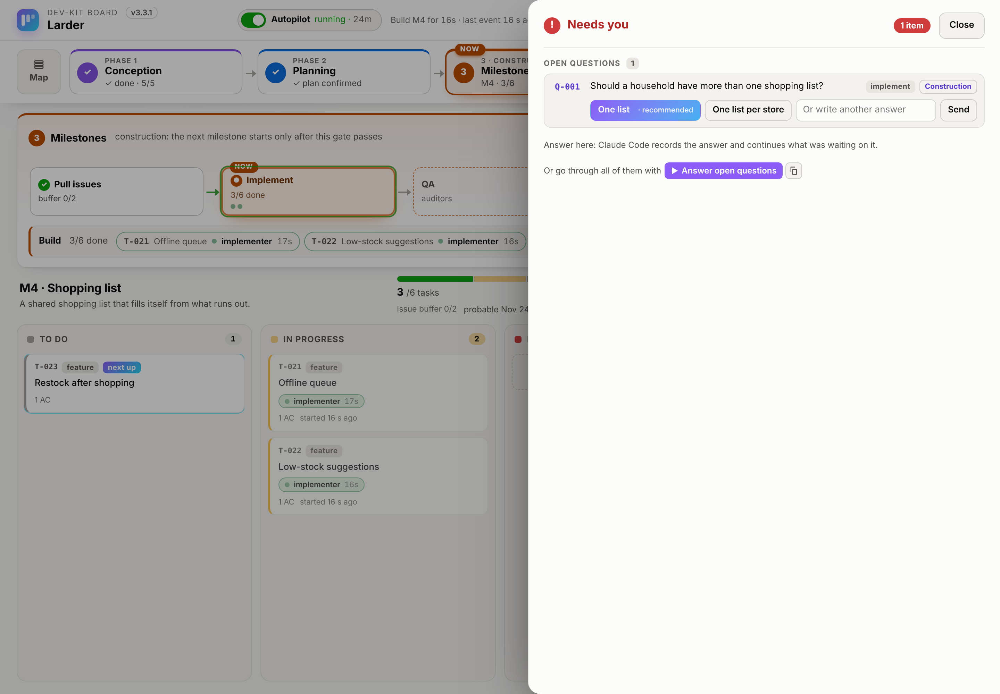
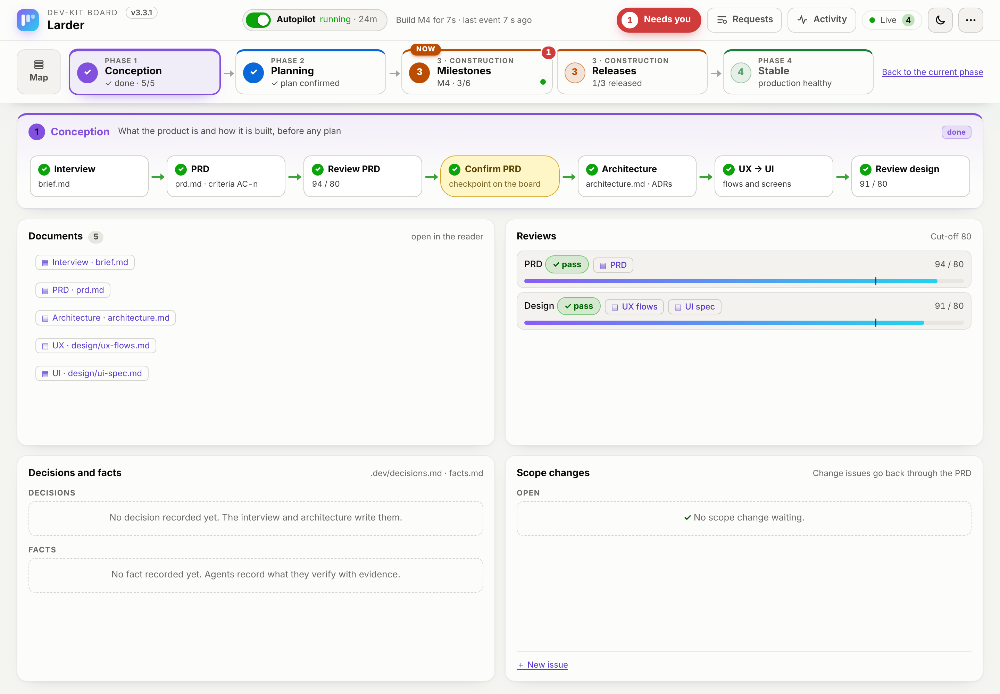
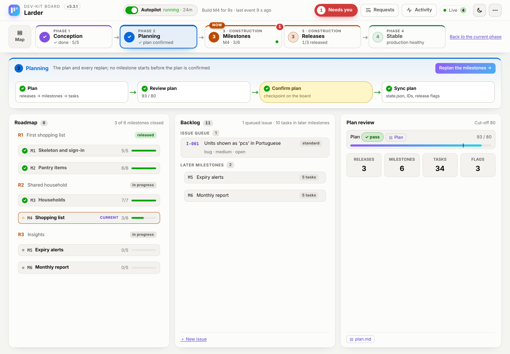
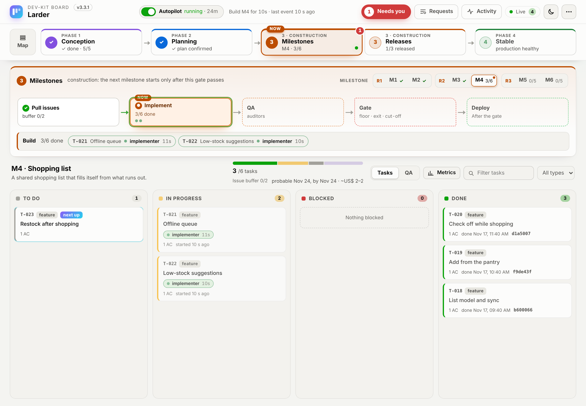
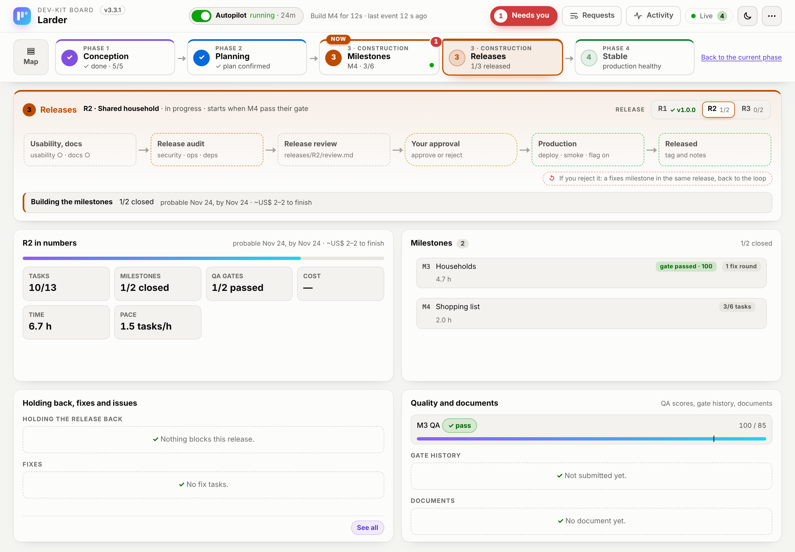
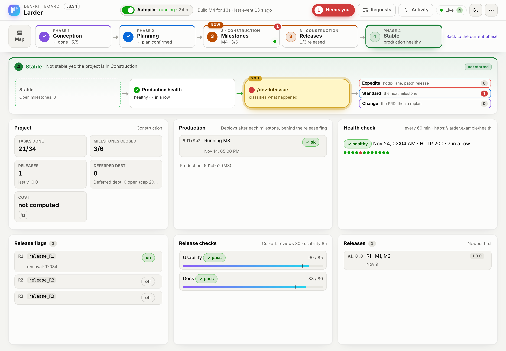

# Stage by stage

What to do at each stage of a project, in the order of the [flow diagram](dev-kit-flow.svg): what to run, what the board shows, what waits for you and how to get unstuck. The first time through, follow [getting started](getting-started.md); come back here when you want to know what a stage expects from you. `/dev-kit:help` answers the same questions inside Claude Code, and `/dev-kit:status` always names the stage and step the project is at.

| Stage | Board tab | What moves it | What waits for you |
|---|---|---|---|
| [Conception](#1-conception) | 1 Conception | `/dev-kit:start`, then the autopilot (or each skill by hand) | the interview, **Confirm PRD** |
| [Planning](#2-planning) | 2 Planning | the autopilot, or `/dev-kit:plan` and `/dev-kit:review plan` | **Confirm plan** (every replan too) |
| [Milestones](#3-milestones) | 3 Milestones | the board's **Autopilot** switch, or `/dev-kit:autopilot` | questions and permissions in **Needs you**, decisions after repeated failed gates |
| [Releases](#4-releases) | 3 Releases | `/dev-kit:release` (the autopilot runs it) | **Approve** or **Reject** the release review |
| [Stable and maintenance](#5-stable-and-maintenance) | 4 Stable | `/dev-kit:issue`, the production health check | scope changes, expedite issues |
| [Coming from 2.x](#6-coming-from-dev-kit-2x) | | the first command after updating | review and confirm the regrouped plan |

## Two ways to drive

Every stage can be driven in two ways, and you can switch at any time:

- **From the board (recommended for long runs).** Open it with `/dev-kit:board` and turn on the **Autopilot** switch in the top bar. The board's server then runs `/dev-kit:autopilot --milestones 1 --board` headless (`claude -p`), one milestone per run with a fresh context, and starts the next run by itself until a release waits for your approval or the project is stable. Every question and every permission prompt goes to **Needs you**; when only work that needs you is left, the run ends and the board starts it again as soon as you answer. You can close the Claude Code session: the board keeps going, and it does not stop for idleness while the Autopilot is on. Its output is in `.dev/run/autopilot.log`.
- **From a Claude Code session.** `/dev-kit:autopilot` runs the same driver in your session and asks its questions in the chat (or parks them, at the `unattended` level). `--until plan` stops after planning, `--milestones N` after N milestones. Or go step by step, one skill at a time (each section below lists them).

Only one autopilot drives a project. While the board's switch is on, a `/dev-kit:autopilot` started by hand does not start a second driver: it tells you the board is driving, and with only `--parallel N` it just changes the number of implementers of the run in progress. While you run the autopilot in a session, the board's Autopilot shows "waiting for another session".



Next to the switch, one word says what it is doing:

| The switch says | What it means | What to do |
|---|---|---|
| off | nothing runs by itself | turn it on when you want the project to move |
| starting · running | a run is starting or in progress (for how long) | nothing; click it for the details |
| finishing the step | you turned it off: the run finishes its step (green work only), then stops | wait, or **Force stop** to end it now |
| waiting for you · N | only work that needs you is left | answer the N items in **Needs you**: the next run starts by itself |
| waiting for your approval | a release review waits for you | **Approve** or **Reject** it in Needs you ([Releases](#4-releases)) |
| waiting for another session | a board request, or an autopilot you started in a session, is working on the project | nothing: it starts when that one ends |
| retrying soon | a run failed; it tries again after 30 s, 2 and 10 minutes | nothing, unless it ends in "stopped" |
| stopped | three runs failed in a row, or a run changed nothing | read the reason in its card and `.dev/run/autopilot.log`, fix the cause, then **Start again** |
| project stable | nothing is open | nothing ([Stable](#5-stable-and-maintenance)) |

**Implementers at once** (on the same card, 1 to 6, default 3) sets how many tasks of a milestone are built in parallel, each implementer in its own git worktree. It applies from the next batch while the running implementers finish; only tasks with no file in common run together; more at once costs no more tokens but uses more CPU and disk and reaches your account's usage limits sooner. The setting is kept on this machine (`.dev/run/autopilot.json`) and is also read by an autopilot you run by hand; `/dev-kit:autopilot --parallel N` changes it from a session. QA keeps its own rule (light auditors together, heavy ones limited by the CPUs).

**Needs you** is the red button in the top bar, with how many items wait (the tab title and icon change too). It opens a drawer with every item and its buttons: open questions (with the recommended answer first, or your own words), **Confirm PRD** and **Confirm plan**, release approvals, permission prompts (Allow, Allow for this session, Deny; with no answer in 10 minutes the prompt is denied and the task is blocked with the reason) and offers such as a queue of issues above its limit. Without the board, `/dev-kit:backlog` lists the same items and `/dev-kit:interview --gaps` goes through the open questions.



**Live**, at the right of the top bar, lists on hover or click what is running now: the autopilot run, a board request, the skills of the session log and their agents.

## 1. Conception

What the product is and how it is built, before any plan.

**Run**

```
/dev-kit:start a personal expense tracker with login and monthly reports
/dev-kit:autopilot --until plan
```

`start` runs the interview (about 10 rounds; every question has a recommended option and a "decide for me" choice) and writes `.dev/brief.md`. The autopilot then writes the PRD and reviews it, stops for your confirmation of the PRD, and goes on with the architecture, the UX and UI specs (only when there is an interface) and the design review. By hand, in this order: `/dev-kit:prd` → `/dev-kit:review prd` → (Confirm PRD) → `/dev-kit:architecture` → `/dev-kit:ux` → `/dev-kit:ui` → `/dev-kit:review design`. With the board up you can also turn the Autopilot on right after the interview: it runs conception and planning and waits at each checkpoint.

**The board shows** tab 1 with the steps as a flow (interview, PRD, review, Confirm PRD, architecture, UX → UI, design review), each done, in progress, waiting for its review or out of date after a change. Below: the documents (each opens formatted in a side panel), the reviews with their score against the cut-off, the decisions recorded in `decisions.md`, and the scope changes waiting.



**Needs you**

- **The interview** is yours: answer in your own language. The answers that matter most later are the quality bar, how much of the run you want to follow (`supervised` or `unattended`), production and the issue buffer. Change them later with `/dev-kit:settings` or `/dev-kit:interview --gaps`.
- **Confirm PRD.** When the PRD review passes, Needs you shows its summary (personas, stories by priority, how many acceptance criteria, what is out of scope) and a link to the whole document. **Confirm**, or **Ask for changes** in your own words: the PRD is revised, reviewed again and comes back to you. The architecture does not start before you confirm. Without the board, tell the session ("confirm the PRD") or run `/dev-kit:backlog`, which lists it.
- Decisions on the always-ask list (paid services, deleting data, public exposure, the security model, credentials) come as questions, each with a recommendation.

**Unstuck**

| Symptom | What to do |
|---|---|
| The architecture never starts | Confirm PRD waits in Needs you |
| A review keeps failing | Read the report in `.dev/reviews/`; from round 2 only the changed text is judged, and after `max_review_rounds` (default 3) the kit asks you what to do |
| The phase went back to conception in the middle of the build | A PRD or design file changed after its review (a scope change, or a hand edit): run the review the board shows, then `/dev-kit:plan replan`; the milestone being built keeps going |
| A step does not apply (no interface) | Nothing: the design review is recorded `n/a` and UX and UI are skipped |

## 2. Planning

The specs become releases, milestones and tasks.

**Run** the same `/dev-kit:autopilot --until plan` (or the board's Autopilot) goes on from conception. By hand: `/dev-kit:plan`, then `/dev-kit:review plan`. To change the plan later: `/dev-kit:plan replan`, or the **Replan the milestones** screen on the board.

**The board shows** tab 2: the flow plan → review → your confirmation → sync, the roadmap grouped by release (R1, R2…; 2 to 5 milestones each, each a complete journey a user can validate), the backlog and the plan review. **Replan the milestones** (from this tab) lets you drag tasks not started and open issues between open milestones, or milestones between releases, add the next milestone and send the draft; nothing changes until you send it.



**Needs you**

- **Confirm plan.** When the plan review passes (and after every replan), Needs you shows the releases, each milestone with its goal, its `exit_check` and its number of tasks. Read it: mistakes are cheapest here. **Confirm**, or **Ask for changes**. No milestone that has not started begins before you confirm; during a replan the milestone in progress keeps going.
- Check each milestone's `exit_check`: the test, command or acceptance criteria that must pass at its gate. It is how you decide what "done" means for that milestone.

**Unstuck**

| Symptom | What to do |
|---|---|
| No milestone starts | Confirm plan waits in Needs you |
| The plan has milestones without an exit check (older plans) | `/dev-kit:plan --annotate-exit` proposes them; until then the gate does not require one |
| You want a different grouping or order | Ask for changes on Confirm plan, or use **Replan the milestones** |

## 3. Milestones

Construction, one milestone after the other: pull the issues, implement, QA, gate, then smoke and deploy. It runs on its own.

**Run** the board's **Autopilot** switch (it runs one milestone per run and starts the next by itself), or `/dev-kit:autopilot` in a session. By hand: `/dev-kit:implement --milestone M1`, then `/dev-kit:qa M1`; repeat `implement` and `qa` while the gate creates fix tasks. Set how many tasks are built at once on the Autopilot card, or with `--parallel N`.

**The board shows** tab 3 Milestones: the milestones grouped by release in a picker; for the one picked, its stages (pull issues, implement, QA, gate, deploy) with where it is, one line with its goal, progress and **forecast** (the probable finish, a later "by" date and the cost to finish), and the task board in four columns (to do, in progress, blocked, done) with the agents running on each card. **QA** shows the rounds and their scores; **Metrics** opens burndown, velocity and gates.



A gate passes only with the hard floor met (the build and the suite pass, no secret in the diff), the milestone's `exit_check` passing and every scored dimension at or above its cut-off. A failed gate creates fix tasks and another QA round; the next milestone starts only after the gate passes. With a deploy per milestone, the milestone then goes to its local preview or to production (behind its release's flag, when release flags are on).

**Needs you**

- **Questions** a task cannot go on without. The task waits (blocked, with the question), the rest of the milestone goes on, and your answer unblocks it.
- **Permission prompts** of the run (a command, an edit outside the project), when the permission mode does not cover them. With the Autopilot or a board request they come to Needs you; in a session, to the terminal.
- **Fix rounds used up**, or the same finding back twice ("needs your decision"): accept with an ADR, replan, or give more rounds. The `unattended` level applies the recommendation by itself, never with a critical or high finding open or security below its minimum.
- **Production deploys** when you set them to ask.

**Unstuck**

| Symptom | What to do |
|---|---|
| The Autopilot says "waiting for you" | Answer what is in Needs you; the next run starts by itself |
| The Autopilot says "stopped" | Its card says why: three failed runs (read `.dev/run/autopilot.log`) or a run that changed nothing (a blocked step the autopilot cannot move: see Needs you and `/dev-kit:backlog`). Fix it, then **Start again** |
| A task stays blocked | Its card says why: a question (answer it), a permission denied (allow it next time, or run `/fewer-permission-prompts`), or the environment (tests or server cannot run) |
| A gate keeps failing | Read `.dev/qa/<M>/report.md`; from round 2 only previous findings and new medium or worse ones count |
| "gate of Mn is pending" | Milestones are sequential: finish `qa Mn` first; only hotfix tasks skip the line |
| "Frozen for QA" when adding work | The milestone is in QA; adding to it needs your confirmation, or put the work in the next milestone |
| The machine is slower than you like | Lower **Implementers at once** (applies from the next batch) |
| A session froze or the machine rebooted | `/dev-kit:start` reconciles `.dev/` with git and stops leftover processes; turn the Autopilot back on (it resumes if it was on) |

## 4. Releases

When every milestone of a release is closed, it is checked, audited and waits for your approval: the one human gate of construction.

**Run** `/dev-kit:release` (the autopilot runs it when a release is ready). It runs the usability audit (apps with an interface), the docs and their review and the release audit, then writes the **release review** (`.dev/releases/R<n>/review.md`: what it delivers against the PRD, scores, risks, how to try it and how to roll back) and stops. `/dev-kit:release --dry-run` shows the checklist and the version it would use without changing anything.

**The board shows** tab 3 Releases: the release picked with its stages (checks, audit, review, your approval, production, released) and the rejection loop, its numbers, its milestones, what holds it back, and its quality and documents. When it waits for you, **Approve** and **Reject** are there and in Needs you, and the Autopilot says "waiting for your approval".



**Needs you**

- **Approve** (on the board, or `/dev-kit:release --approve`): the kit tags the version, deploys to production when there is one, runs the smoke checks and records the release. With release flags, the flag of the release is turned on.
- **Reject** with what must change (on the board, or `/dev-kit:release --reject "what must change"`): it becomes a fixes milestone in the same release (`M<k>.<i>`, for example `M5.1`), built and gated like any other, and the release comes back to you. No milestone of the next release reaches the main branch before; while you decide, its first milestone may be built ahead on its own branch (`autonomy.pipeline`).

**Production before the release** (optional): with `/dev-kit:settings` turn on release flags and set production to `per_milestone_flagged`. Each milestone then goes to production as soon as its gate passes, with its release's flag off; approval turns the flag on, `/dev-kit:deploy --rollback R2` turns it off again, and a chore to remove the flag is planned in the next release.

**Unstuck**

| Symptom | What to do |
|---|---|
| `release` stops on missing reviews | Every review must pass (or be `n/a`): run the one it names, `/dev-kit:review <target>` or `/dev-kit:usability` |
| The Autopilot stopped at a release | Expected: it waits for your approval and starts again after it |
| The production deploy failed | The kit rolls back when the service is down and creates a fix task; `/dev-kit:deploy --check` shows what is deployed, `--dry-run` what it would do |
| The version proposed looks wrong (existing project) | `release` asks which source is right; the tag prefix follows your project |

## 5. Stable and maintenance

Nothing is open: no milestone in progress, no issue queued, everything released. A resting point, not an end.

**Run** `/dev-kit:issue "what happens"` for any bug, improvement or change. The kit proposes a class: `expedite` (a critical or high bug in delivered work: a hotfix, one at a time, released as a patch), `current` (the milestone being built), `standard` (the next milestone's buffer), `intangible` (polish, in the cool-down) or `change` (new or changed behaviour). A bug or improvement goes straight to construction; a scope change reopens conception (only the PRD and the specs it affects) and planning, while the milestone being built keeps going. `/dev-kit:backlog` shows everything pending.

**The board shows** tab 4 Stable: the flow ends in the three classes of service (expedite, standard, change) with their queues, then the project totals, production, the health check, release flags, release checks and releases.



**Production health check** (optional, `/dev-kit:settings`: a command or an `https://` URL and an interval): it runs on schedule while the board is open, or with `/dev-kit:deploy --health`. A failure opens one expedite issue (later failures update it) and an item in Needs you.

**Needs you**: a failing health check, a hotfix to release, a scope change to confirm through Confirm PRD and Confirm plan, and offers on the issue queue (plan a milestone for a queue above its limit, schedule or park issues that have waited long).

**Unstuck**

| Symptom | What to do |
|---|---|
| The project never reaches stable | A closed milestone waits for its release, or an issue is queued: `/dev-kit:status` says which; release it or schedule the issue |
| An issue never gets scheduled | Standard and intangible issues wait for a buffer or the cool-down: `/dev-kit:issue --schedule I-003 M8` brings one into a milestone |
| "hotfix … is still open (WIP 1)" | Finish the open one (`implement`, `qa --scope`, `release --hotfix`) or classify the new one as standard |
| Maintenance only, in an existing project | The entry mode `maintenance` keeps an open maintenance milestone that issues fill; its gate runs like any other, and you close its release with `/dev-kit:release` |

## 6. Coming from dev-kit 2.x

A project built with 2.x moves to 3.x in place: you do not start over.

1. Update the plugin (`/plugin marketplace update dev-kit`) and start a new Claude Code session in the project. If a board was running, stop it (`/dev-kit:board stop`) and start it again: an old board says "started by another version".
2. Run `/dev-kit:start`. The first command that reads the old `state.json` copies it and `plan.md` to `.dev/backup/` before anything changes, and `.dev/.gitignore` gets its managed block (your own rules stay).
3. The next `sync-plan` (any skill that syncs the plan runs it) regroups the plan into releases: milestones already released go under `## R0 — Released before 3.0`, with every version and tag kept; the others under `## R1`; maintenance milestones under `## R<k> — Maintenance`. It records an ADR and marks the plan review out of date. Board requests named `R-nnn` show as `P-nnn`.
4. Run `/dev-kit:review plan` (or let the autopilot do it) and **Confirm plan** on the board. Until you confirm, no milestone that has not started begins; the one in progress goes on.
5. Optional: `/dev-kit:plan --annotate-exit` adds an `exit_check` to the open milestones, so their gates require it; with CI in the project, the gate also looks for a green run (`/dev-kit:settings` turns that off).
6. "Go on by itself" from 2.x is now the **Autopilot** switch: a project that had it on starts with the Autopilot on.

New in 3.x for everyone coming from 2.x: you confirm the PRD and the plan, every release waits for your approval, each milestone has an exit check, and the board can drive the whole run (the Autopilot switch, from 3.2) with several implementers at once (from 3.3).
