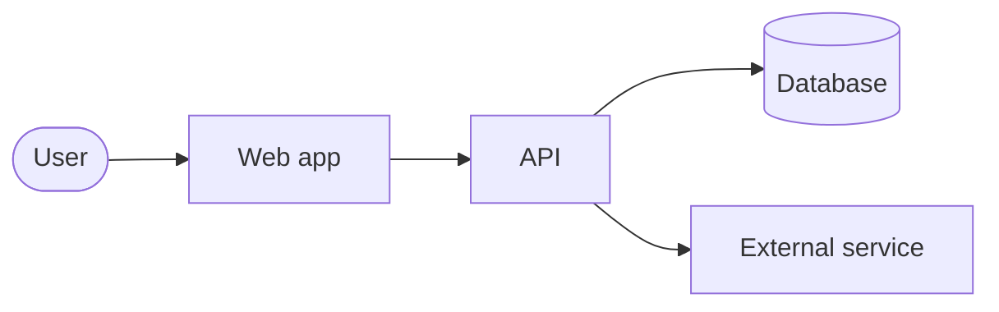
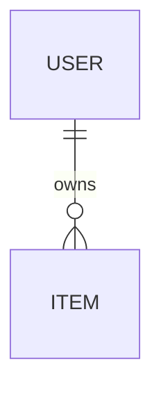

# Architecture — {{project_name}}

> Purpose: the technical shape of the system so tasks can be implemented without re-deciding. Derived from `brief.md`, `prd.md` and stack detection on {{date}}. Status: draft | approved.

## 1. Stack decision
| Layer | Choice | Version | Why (ADR) |
|---|---|---|---|
| Language | | | ADR-001 |
| Framework | | | |
| Database / ORM | | | |
| Auth | | | |
| Testing | | | |
| Lint / format | | | |
| Package manager / runtime | | | |
| Hosting / CI | | | |

Detected from: {{detected_from}} (or "greenfield, chosen"). Existing projects: mark each row `as-built` (link the `source: discovered` ADR) or `planned` (new, its own ADR); if the project already has an architecture document, link it here and record only what changes.

## 2. System context (C4 level 1–2)


## 3. Repository structure
```
src/
  ...
tests/
```
Module boundaries and what may import what.

## 4. Data model

Per entity: fields, types, constraints, indexes, soft-delete/retention rules (from brief block 4).

## 5. Contracts
- API style (REST/GraphQL/RPC), versioning, error format, pagination.
- Endpoint or operation inventory (method, path, auth, request/response summary, ACs served).
- Events/jobs, if any.

## 6. Cross-cutting concerns
Auth & permissions model · validation strategy · error handling & logging · configuration & secrets (env var names) · i18n · accessibility baseline · performance budget · security controls (OWASP mapping).

## 7. Environments and deployment
dev / staging / prod, how each is run, migrations strategy, CI pipeline steps.
Production (if `production.when` is not `none`): method and host · install command (with dry-run if any) · migrate command · rollback command · backup location · smoke checks · prerequisites (name → how it is provided; never the value).
Local preview (if `local_deploy` is on): build + start command, port, bind address `127.0.0.1`, smoke check (URL or example command), stop command.

## 8. Testing strategy and commands (summary; details in `qa/test-plan.md`)
Pyramid per layer, tools, what must be e2e, coverage target.

| Purpose | Command |
|---|---|
| install dependencies | |
| run (dev) | |
| test (full suite) | |
| lint / format check | |
| type-check | |
| build | |
| e2e | |

Skills and agents run exactly these commands (`implement`, `qa`, `test`, `release`, `resource-isolation.md`). Existing projects: copy them from `discovery.md` §3–4.

## 9. Open points
Items delegated to implementation time (category + where the decision will be logged).
