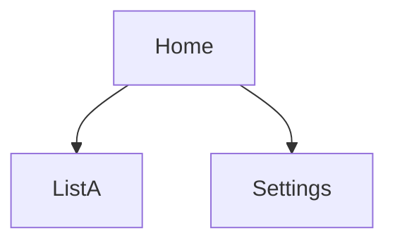
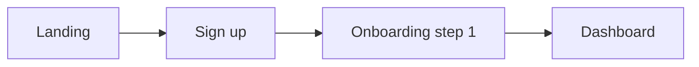

# UX flows — {{project_name}}

> Purpose: how users move through the product and what every state looks like, before any pixel is drawn. Derived from `prd.md` (stories, ACs) and `brief.md` block 7 on {{date}}. Status: draft | approved.

## 1. Principles for this product
3–6 statements derived from the brief (e.g. "one primary action per screen", "never lose user input", "works one-handed on mobile").

## 2. Information architecture

Navigation model (tabs, sidebar, wizard), entry points, deep links.

## 3. Journeys
One section per persona × top task. Each journey: trigger → steps → success state → metrics.

### J-1 — {{persona}} completes {{task}} (US-1, AC-1..AC-3)

| Step | Screen | User intent | System response | Error / edge cases |
|---|---|---|---|---|

## 4. Screen inventory
| Screen id | Name | Purpose | Primary action | Reached from | Stories | Tag |
|---|---|---|---|---|---|---|
| S-01 | | | | | | new |

`Tag` is used in existing projects only: `existing` (one line with route and file; no states or forms specified), `changed` or `new` (fully specified below). New projects leave it empty.

## 5. States per screen
For each screen: loading · empty (first use) · partial · error (network, validation, permission) · success/confirmation · offline (if applicable). Specify copy and the recovery action for each.

## 6. Forms and validation
Field list per form, inline vs on-submit validation, error message pattern, autosave/undo rules.

## 7. Microcopy guide
Tone (brief block 7), button verbs, confirmation and destructive-action patterns, empty-state voice, examples in the application language(s).

## 8. Usability checkpoints
Heuristics (`shared/checklists/nielsen-10.md`) that matter most here and how each flow satisfies them; accessibility implications for `ui-spec.md`.
