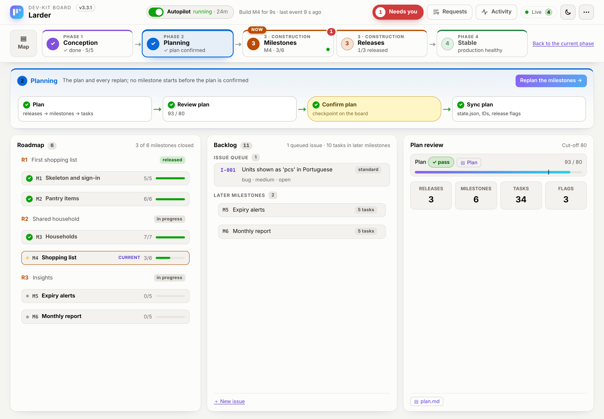
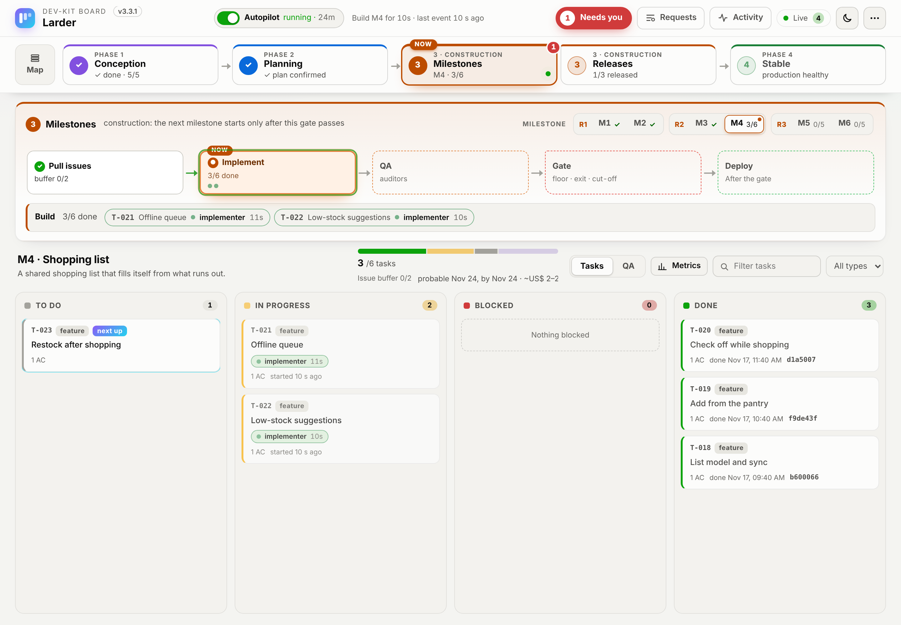
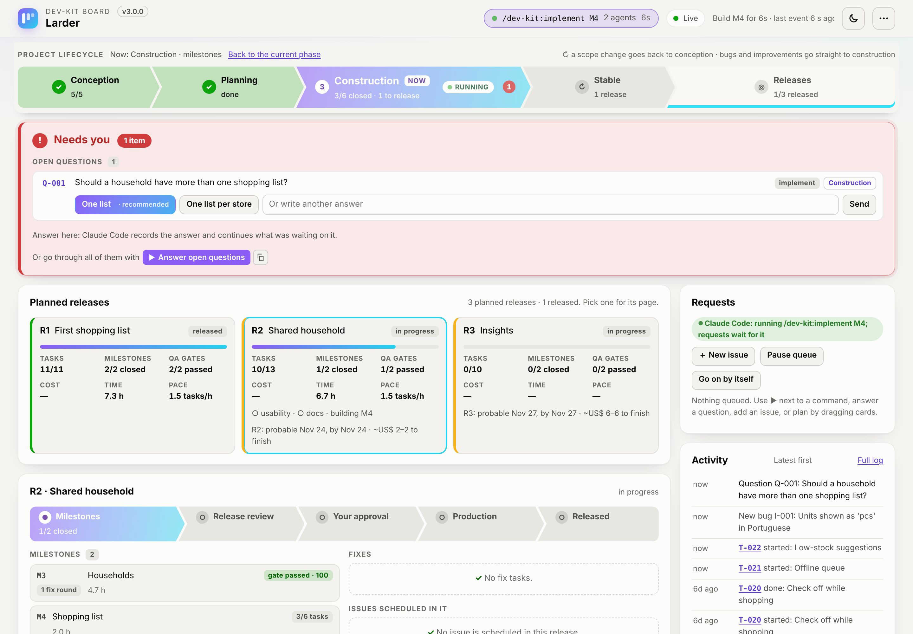
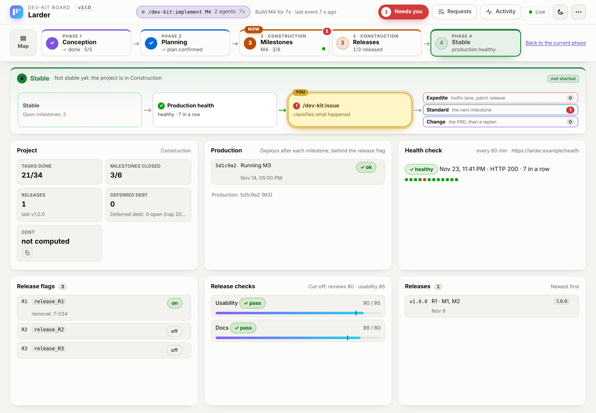
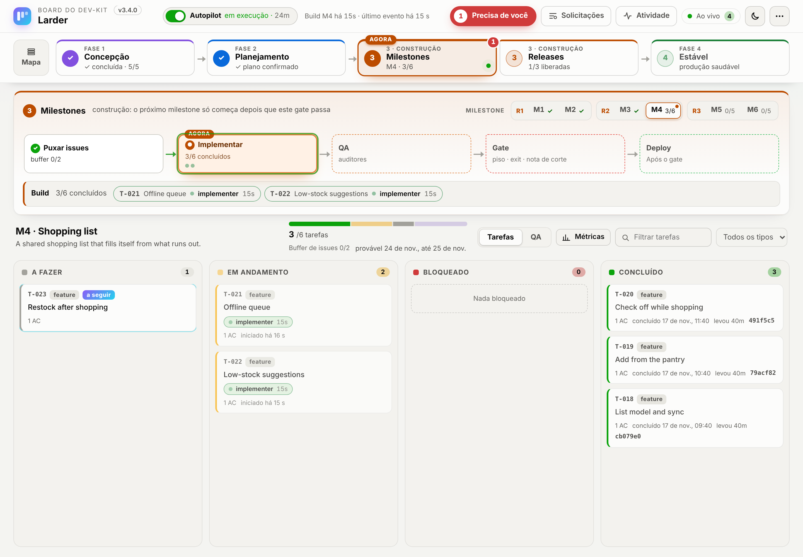

# Get started with dev-kit

The quickstart: the minimum you need to build your first project, and what you will see along the way. Install the plugin first (see the [README](README.md#install)).

<p align="center">
  
</p>

## 1. Open a folder in Claude Code

```
mkdir my-app && cd my-app
claude
```

dev-kit works on the folder where you run it. It will run `git init` for you if needed, because it makes one commit per task.

**Already have code?** Open Claude Code in that repository and run `/dev-kit:start <the change you want>`. The kit first adopts the project without touching your code: it tags a baseline, writes `.dev/discovery.md` and asks whether you want a new feature, maintenance only (bugs and small improvements through `/dev-kit:issue`) or to import your existing PRD/specs. Then continue from step 3.

## 2. Start

```
/dev-kit:start a personal expense tracker with login and monthly reports
```

Describe your idea in one sentence, or run `/dev-kit:start` with no text. The kit starts an interview about the product, users, scope, data, stack, design, quality bar and how much autonomy you want it to have. Answer in your own language; every question comes with a recommended option. The answers are saved in `.dev/brief.md`.

## 3. Plan, then read the plan

```
/dev-kit:autopilot --until plan
```

This writes and reviews the PRD, architecture, UX/UI design and implementation plan, all in `.dev/`. After the PRD review and again after the plan review, the kit stops at a **checkpoint**: open the board (`/dev-kit:board`), read the summary in **Needs you** (the link opens the whole document) and **Confirm**, or **Ask for changes** in your own words. Nothing is built before you confirm the plan.

<p align="center">
  
</p>

## 4. Build

```
/dev-kit:autopilot
```

The kit implements the plan milestone by milestone, with tests, and runs a quality gate at the end of each one: a hard floor (build, tests, no secrets), the milestone's `exit_check` and a score per dimension. It pauses only for decisions that need you; questions show up in **Needs you** with a recommended answer.

**Or let the board drive it.** On the board, turn on the **Autopilot** switch in the top bar: the board runs the autopilot itself, headless, one milestone per run, until a release waits for your approval. Questions and permission prompts wait in Needs you while independent work goes on, and the next run starts as soon as you answer. Its card sets **Implementers at once** (1 to 6, default 3), how many tasks are built in parallel. You can close Claude Code meanwhile. What each word next to the switch means: [stage by stage](.claude/plugins/dev-kit/docs/stages.md#two-ways-to-drive).

<p align="center">
  
</p>

## 5. Release, then keep evolving

The plan groups milestones into **planned releases** (R1, R2…). When every milestone of a release is closed, `/dev-kit:release` runs the usability audit (apps with a UI), the docs and the release audit, writes the **release review** (`.dev/releases/R<n>/review.md`) and waits for your approval: approve on the board (Needs you) or by running `/dev-kit:release` again, or reject with what must change, which becomes a fixes milestone of the same release. With nothing open and everything released, the project is **stable**.

<p align="center">
  
</p>

If you want each milestone in production as soon as it passes its gate, turn on **release flags** in `/dev-kit:settings`: the new code goes out behind the release's flag, off, and the flag is turned on only after you approve the release. A **production health check** (a command or a URL) runs on a schedule; a failure opens an urgent issue and shows in Needs you.

<p align="center">
  
</p>

From there the product keeps living: `/dev-kit:issue "what happens"` sends a bug or improvement straight to construction (a new task in a milestone), while a scope change reopens conception and planning, only for what changed, and the milestone being built keeps going. The phase you see (`conception · prd`, `construction · M3`, `stable`) is worked out from `.dev/`, so it always matches the work.

## Day-to-day commands

| I want to... | Run |
|---|---|
| resume the project after a break | `/dev-kit:start` |
| know what to do next, or ask a "how do I...?" question | `/dev-kit:help` |
| see progress and blockers | `/dev-kit:status` |
| watch it live in the browser | `/dev-kit:board` |
| let the board drive the build | the **Autopilot** switch on the board |
| report a bug or ask for a change | `/dev-kit:issue "what happens"` |
| see everything still pending | `/dev-kit:backlog` |
| put an approved milestone in production | `/dev-kit:deploy` |
| submit a finished release for approval | `/dev-kit:release` |
| change autonomy, flags, the board language | `/dev-kit:settings` |
| see how much it cost | `/dev-kit:costs` |
| get an evaluation of the session | `/dev-kit:feedback` |
| draw the architecture diagram of what is being built (also the board's Architecture button) | `/dev-kit:diagram` |
| find out why a run looks stuck, or make a dump for a dev-kit patch | `/dev-kit:debug` |

## Good to know

- **Everything is a file.** Specs, plan, state and logs live in `.dev/`; never edit `.dev/state.json` by hand.
- **You can go step by step** instead of autopilot: `prd`, `review prd`, `architecture`, `ux`, `ui`, `review design`, `plan`, `review plan`, `implement`, `qa`, in that order (each review scores the document; `release` requires them). `/dev-kit:status --next` (or `/dev-kit:help`) names the step the project is at.
- **The board speaks your language.** It shows the project's language (English or Portuguese for now), else your browser's; the menu switches it, and the choice is kept in that browser.

<p align="center">
  
</p>

- **Coming from dev-kit 2.x?** Update the plugin and run `/dev-kit:start`: the project moves to 3.x in place (a backup goes to `.dev/backup/`), and you confirm the plan regrouped into releases. Details: [coming from 2.x](.claude/plugins/dev-kit/docs/stages.md#6-coming-from-dev-kit-2x).
- **Stuck or lost?** Run `/dev-kit:help`, see [stage by stage](.claude/plugins/dev-kit/docs/stages.md) (what each stage expects from you and how to get unstuck) or [troubleshooting](.claude/plugins/dev-kit/docs/troubleshooting.md).

Next: the longer [getting-started guide](.claude/plugins/dev-kit/docs/getting-started.md), [stage by stage](.claude/plugins/dev-kit/docs/stages.md) and the [recipes](.claude/plugins/dev-kit/docs/recipes.md).
