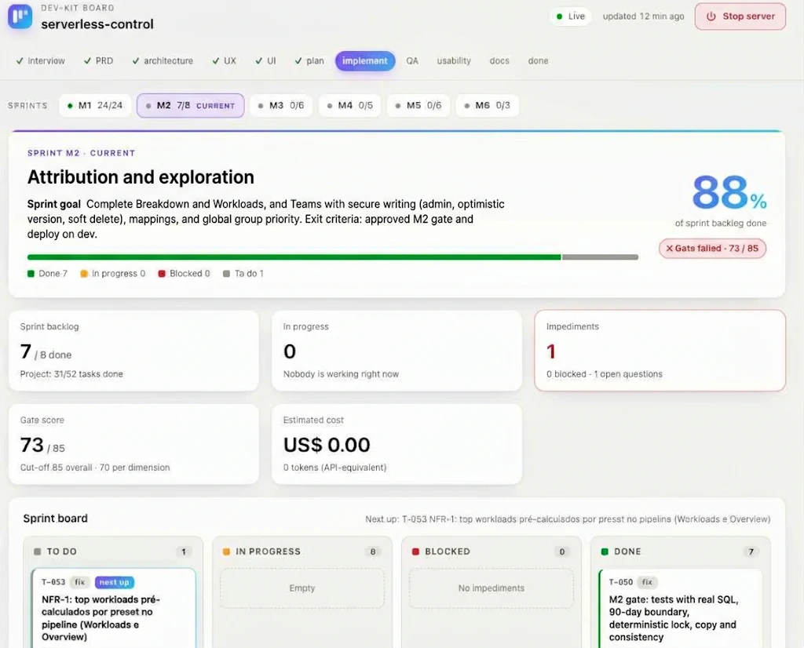

# dev-kit

A [Claude Code](https://claude.com/claude-code) plugin that builds a complete application, from requirements interview to release.

You answer one thorough interview. The kit then writes the PRD, architecture and design, plans the work, implements it task by task with tests, audits every milestone and prepares the release. It stops only when it needs a decision from you, and everything it produces is kept in a `.dev/` folder inside your project, so you can stop and resume at any time.

<p align="center">
  
  <br>
  <sub><code>/dev-kit:board</code> shows the build in <b>real time</b> in your browser: sprint goal, kanban, burndown, impediments and quality gates.</sub>
</p>

## What it does

- **Skills for the whole lifecycle**, invoked as `/dev-kit:<name>`, such as `interview`, `prd`, `architecture`, `ux`, `ui`, `plan`, `implement`, `test`, `qa`, `review`, `usability`, `docs`, `release`, `deploy`, plus `autopilot`, `status`, `board`, `backlog`, `issue`, `costs`, `feedback`, `help` and `start`.
- **Specialised agents** that the skills call: an implementer, an architecture consultant and a team of read-only reviewers (code, security, tests, accessibility, data, performance, copy and more).
- **Quality gates**: each milestone ends with a scored review (0-100 per dimension) that must clear a cut-off before the next one starts.
- **Adjustable autonomy**: from supervised (asks at each decision, always with a recommendation) to unattended (parks what needs you and keeps going).
- **Bugs and ideas** found at any time are classified and routed with `/dev-kit:issue`, without renumbering the plan.
- **Resumable**: state lives in `.dev/` and is reconciled with git on every `/dev-kit:start`.

The kit talks to you, and writes your project's artifacts, in your language. Its own files are in English.

## Install

This repository is a Claude Code plugin marketplace (`dev-kit`) that contains the `dev-kit` plugin. In Claude Code, register the marketplace once and install the plugin:

```
/plugin marketplace add efranceschi/dev-kit
/plugin install dev-kit@dev-kit
```

To use a local clone instead, replace the first line with `/plugin marketplace add /path/to/this/folder`.

To try it without installing, for example while editing the kit:

```
claude --plugin-dir ./.claude/plugins/dev-kit
```

**Teams:** to offer the plugin to everyone who opens a project, add this to the project's `.claude/settings.json`:

```json
{
  "extraKnownMarketplaces": {
    "dev-kit": { "source": { "source": "github", "repo": "efranceschi/dev-kit" } }
  },
  "enabledPlugins": { "dev-kit@dev-kit": true }
}
```

**Claude Agent SDK:** there is no marketplace step. Clone this repository and load the plugin by path:

```python
ClaudeAgentOptions(plugins=[{"type": "local", "path": "/path/to/dev-kit/.claude/plugins/dev-kit"}])
```

```ts
query({ prompt, options: { plugins: [{ type: "local", path: "/path/to/dev-kit/.claude/plugins/dev-kit" }] } })
```

Requirements: Claude Code, `git` and `python3` (the kit's helper scripts use only the standard library). Keep the `core` skill installed next to the other skills; it holds the scripts and templates they share.

## Get started

Read **[GET_STARTED.md](GET_STARTED.md)** for the minimum you need to run your first project.

## Documentation

Full documentation lives in [`.claude/plugins/dev-kit/docs/`](.claude/plugins/dev-kit/docs/):

| Page | For |
|---|---|
| [getting-started](.claude/plugins/dev-kit/docs/getting-started.md) | a step-by-step first project |
| [recipes](.claude/plugins/dev-kit/docs/recipes.md) | "how do I...?" (report a bug, overnight run, costs, deploy, resume) |
| [skills](.claude/plugins/dev-kit/docs/skills.md) | every skill: when to use it, arguments, examples, outputs |
| [agents](.claude/plugins/dev-kit/docs/agents.md) | every agent and who calls it |
| [concepts](.claude/plugins/dev-kit/docs/concepts.md) | state, gates, autonomy, issues, deploy, costs |
| [troubleshooting](.claude/plugins/dev-kit/docs/troubleshooting.md) | when something goes wrong |

Inside Claude Code, `/dev-kit:help` answers "what do I do next?" and `/dev-kit:help <question>` answers "how do I...?".

## Repository layout

```
.claude-plugin/marketplace.json   marketplace manifest
.claude/plugins/dev-kit/          the plugin: skills/, agents/, docs/
```
